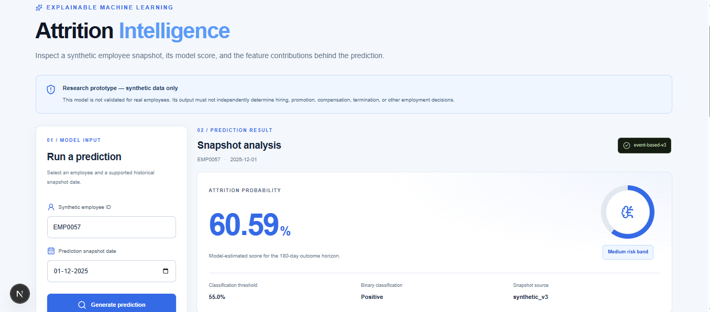
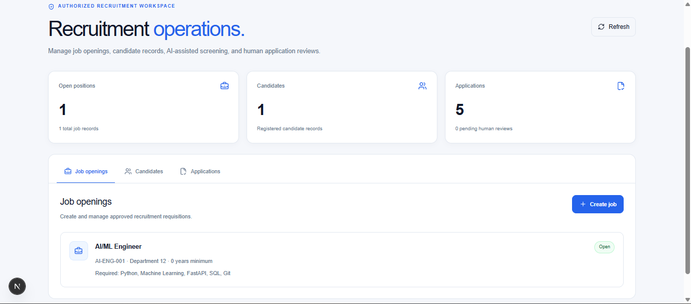
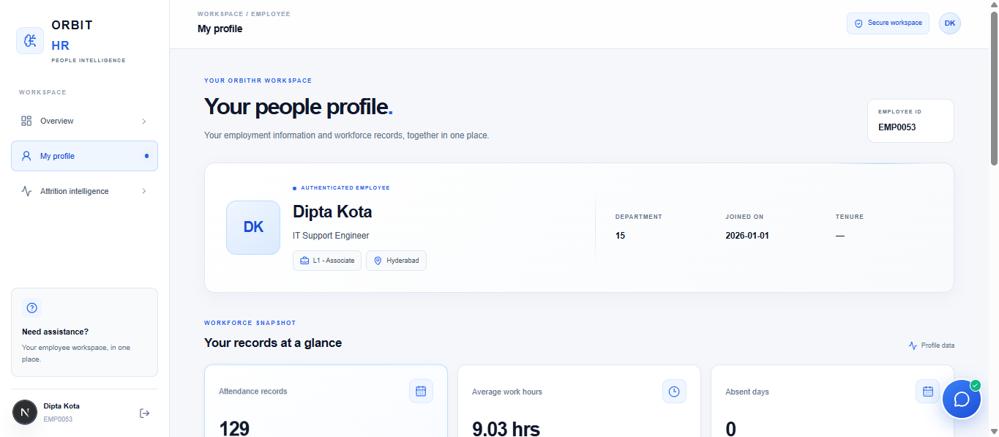
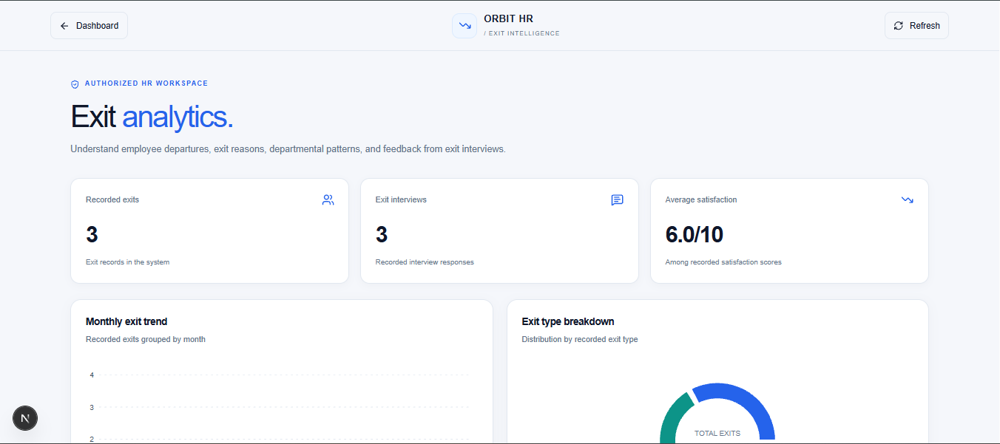
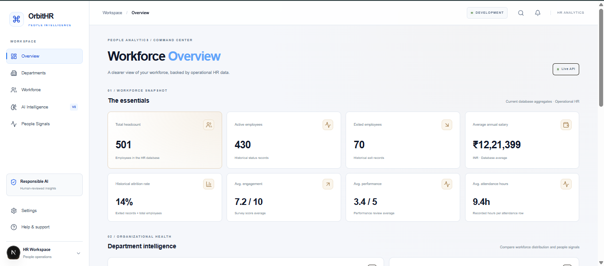
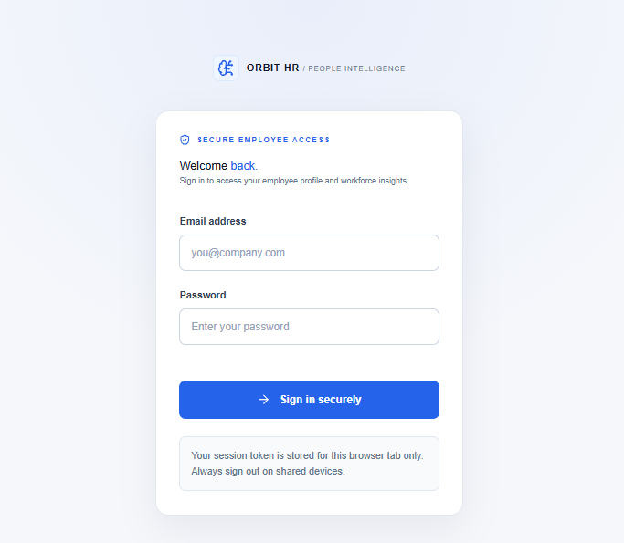

<div align="center">

# OrbitHR
### AI-Native HR Platform

**Workforce Operations · People Analytics · Recruitment · Responsible AI**

[](https://nextjs.org/)
[](https://fastapi.tiangolo.com/)
[](https://www.postgresql.org/)
[](#license)

</div>

An AI-enabled Human Resources platform designed to bring workforce operations, employee self-service, recruitment, people analytics, and responsible AI into one interface.

<p align="center">
  
</p>

## Contents

- [Overview](#overview)
- [Key Areas](#key-areas)
- [Screenshots](#screenshots)
- [Technology Stack](#technology-stack)
- [Architecture](#architecture-at-a-glance)
- [Getting Started](#getting-started)
- [Security and Privacy](#security-and-privacy)
- [Current Scope and Limitations](#current-scope-and-limitations)
- [License](#license)

## Overview

OrbitHR is a full-stack HR platform project built around a shared workforce workspace. It combines operational HR data with analytics-oriented views and AI-assisted experiences, with an emphasis on clear interfaces, role-aware access, and human review.

The current interface includes workforce overview, employee self-service, recruitment operations, exit analytics, and an Attrition Intelligence research view. The attrition model view is explicitly a **synthetic-data research prototype** and must not be treated as a validated predictor for real employees or used as the sole basis for employment decisions.

## Key Areas

| Module | What it provides |
|---|---|
| **Workforce Overview** | Workforce snapshot and HR database aggregates, including headcount, active and exited employee counts, salary averages, and people metrics. |
| **Employee Workspace** | Employee profile and personal workforce information, with attendance-related summary metrics. |
| **Recruitment Operations** | Views for job openings, candidates, and applications. |
| **Attrition Intelligence** | Research interface for a synthetic-data, event-based logistic-regression model, including an estimated score and feature-contribution explanations. |
| **Exit Analytics** | Exit-record summaries, exit interview metrics, and visual breakdowns of recorded departures. |
| **HR Assistant** | Chat-style interface for HR questions and guidance. Responses should be checked against official policy and HR guidance. |
| **Authentication and access control** | Sign-in flow and role-aware backend access controls. |

> **Responsible AI:** Attrition Intelligence is a research prototype based on synthetic employee histories. It has not been validated for real employee outcomes. Its output must not independently determine hiring, promotion, compensation, termination, or other employment decisions. Keep a human reviewer involved.

## Screenshots

Add the supplied screenshots to `docs/screenshots/` using the filenames below, or update the paths in this section to match your repository.

### Workforce Overview


### Attrition Intelligence


### Recruitment Operations


### Employee Workspace


### Exit Analytics


### HR Assistant


### Login


## Technology Stack

### Backend
- Python
- FastAPI
- SQLAlchemy
- Alembic
- PostgreSQL
- JWT bearer-token authentication

### Frontend
- Next.js App Router
- React
- TypeScript
- Tailwind CSS and application-specific CSS
- Lucide icons

### Analytics and AI
- Event-based logistic-regression attrition research model
- Feature-contribution explanations
- Workforce and exit analytics views

> The list above describes the project's established architecture and visible application areas. Confirm each module's current implementation and configuration in the code before representing it as production-ready.

## Architecture at a glance

```text
Browser
  |
  v
Next.js / React frontend
  |
  | HTTP requests + bearer token where required
  v
FastAPI backend
  |
  v
SQLAlchemy
  |
  v
PostgreSQL database

Alembic -> database schema migrations
```

The frontend communicates with the FastAPI API. Protected endpoints use bearer-token authentication and backend role checks. The attrition research endpoint is HR/Admin restricted; do not remove those server-side checks to work around a frontend authorization error.

## Repository Structure

The project uses a backend/frontend layout. The exact contents may evolve as development continues.

```text
OrbitHR-AI-Native-HR-Platform/
├── backend/
│   ├── app/
│   │   ├── api/
│   │   └── security/
│   ├── alembic/
│   └── ...
├── frontend/
│   ├── src/
│   │   └── app/
│   └── ...
├── README.md
└── ...
```

## Getting Started

### Prerequisites

Install the following before running the project:

- Python 3.13 or a compatible version supported by the backend dependencies
- Node.js and npm
- PostgreSQL
- Git

### 1. Clone the repository

```bash
git clone https://github.com/vxhll/OrbitHR-AI-Native-HR-Platform.git
cd OrbitHR-AI-Native-HR-Platform
```

### 2. Configure PostgreSQL

Create a local PostgreSQL database, for example:

```sql
CREATE DATABASE orbithr_db;
```

Configure the backend database connection using the environment variable or configuration mechanism already supported by your local backend. **Do not commit database passwords, signing keys, or real employee data.**

### 3. Set up the backend

From the repository root:

```bash
cd backend
python -m venv .venv
```

Activate the virtual environment.

**Windows Command Prompt**
```bat
.venv\Scripts\activate
```

**PowerShell**
```powershell
.\.venv\Scripts\Activate.ps1
```

Install the project's backend dependencies using the repository's dependency file. If it is named `requirements.txt`:

```bash
pip install -r requirements.txt
```

Apply migrations using the repository's Alembic configuration:

```bash
alembic upgrade head
```

Start the API from the directory and module where the FastAPI application is defined. For example, if the app object is `app.main:app`:

```bash
uvicorn app.main:app --reload
```

Open the Swagger UI at `http://127.0.0.1:8000/docs` if the API is running on the default local address.

> **Configuration note:** Confirm the actual FastAPI import path, environment-variable names, and dependency file in your checked-out repository. Use the project's existing configuration rather than creating a second configuration convention.

### 4. Set up the frontend

Open a second terminal:

```bash
cd frontend
npm install
```

Create or update the frontend environment file if your project uses one. The API base URL can be configured as:

```env
NEXT_PUBLIC_API_BASE_URL=http://127.0.0.1:8000
```

Start the development server:

```bash
npm run dev
```

Open `http://localhost:3000`.

### 5. Sign in and test

Use an account configured for your local development environment. Verify the role assigned to that account before testing protected HR/Admin features. Do not publish credentials or tokens in the README, screenshots, issue reports, or source control.

## API and Access Control

- FastAPI provides the backend API.
- Protected frontend requests should include the bearer token required by the backend.
- Authorization must be enforced on the server, not only by hiding frontend links.
- HR/Admin-only endpoints should retain their backend role dependencies.
- Treat `401 Unauthorized` as an authentication/session issue and `403 Forbidden` as an access/role issue; investigate the response rather than removing access checks.

The exact endpoint list and request/response schemas should be taken from the current Swagger UI or API route definitions.

## Testing

Run the tests available in the repository. For a pytest-based backend test suite:

```bash
cd backend
python -m pytest -v
```

Use the frontend's configured scripts to run linting, type checks, or production builds. Check `frontend/package.json` for the available script names before running them.

Before publishing a release, verify:
- database migrations apply cleanly to a fresh development database;
- protected endpoints reject missing or invalid tokens;
- role restrictions are enforced server-side;
- the frontend handles API errors and expired sessions clearly;
- no secrets, tokens, or real employee records are committed.

## Security and Privacy

- Keep `.env` files, credentials, JWT signing keys, database passwords, and access tokens out of Git.
- Use synthetic or anonymized data in development and screenshots.
- Apply least-privilege access and server-side authorization.
- Do not expose personal employee information in logs, screenshots, or public issues.
- Follow applicable privacy, employment, and organizational policies before using the platform with real workforce data.

## Current Scope and Limitations

OrbitHR is an evolving project. Feature availability and maturity may vary by module. The attrition model is a research prototype and is not a validated employment decision system. Analytics depend on the records and calculations available in the configured database; empty or demo datasets may produce limited results.

Do not describe the application as production-ready, fully automated, or validated for employment decisions unless that has been independently verified.

## Roadmap

Potential next steps, subject to the current implementation:

- [ ] Expand automated backend and frontend test coverage
- [ ] Document API endpoints and example responses
- [ ] Improve accessibility and responsive-layout testing
- [ ] Add deployment and environment-configuration documentation
- [ ] Document data provenance, model evaluation, limitations, and human-review procedures
- [ ] Add CI checks for tests, linting, and type safety

## Contributing

Contributions and feedback are welcome. For changes:
1. Create a focused branch.
2. Keep credentials and personal data out of commits.
3. Add or update tests where appropriate.
4. Document configuration or API changes.
5. Submit a pull request describing the change and how it was tested.

## License

**All rights reserved.**

Copyright (c) 2026 Vishal J.

This project is provided for viewing and evaluation purposes only. You may not copy, modify, redistribute, publish, or use this project's source code, design, or other materials without prior written permission from the author, except where applicable law permits otherwise.

To request permission, contact the repository owner through [GitHub](https://github.com/vxhll).

No license is granted to use, copy, modify, or distribute this project unless the author gives explicit written permission.

---

<div align="center">

**OrbitHR · AI-Native HR Platform**

*Workforce operations and people intelligence, designed with responsible AI and human review in mind.*

[Back to top](#orbithr)

</div>
